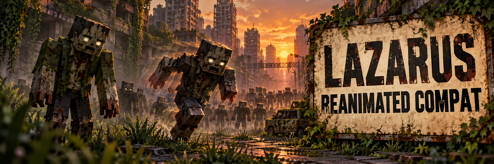

<p align="center">
  
</p>

<p align="center">
  
  
  
  
</p>

# Lazarus — Apocalypse Reanimated Compat

**Lazarus — Apocalypse Reanimated Compat** é um resource pack experimental para o **Project Lazarus**. Seu objetivo é aplicar os modelos e as animações do **Reanimated Blue** aos Walkers, Runners e Hordes do **Apocalypse Now**, preservando as texturas das entidades.

O projeto fornece um gerador em Python e a documentação para produzir o ZIP de compatibilidade. **Não é um mod Forge:** o arquivo gerado deve ser instalado em `resourcepacks`, não em `mods`.

> A estrutura e a integridade do ZIP foram verificadas. Animações, seleção de variantes, armaduras e interação com outros packs ainda precisam de validação visual no Minecraft. Esta versão não deve ser considerada estável.

---

## Sumário

- [O que o pack cobre](#o-que-o-pack-cobre)
- [Como funciona](#como-funciona)
- [Instalação](#instalação)
- [Gerar a partir do código](#gerar-a-partir-do-código)
- [Estado dos testes](#estado-dos-testes)
- [Créditos e distribuição](#créditos-e-distribuição)

---

## O que o pack cobre

| Família | IDs selecionados | Quantidade |
|---|---|---:|
| **Walkers** | `apocalypsenow:walker_1` a `walker_33` | 33 |
| **Runners** | `apocalypsenow:runner_34` a `runner_57` | 24 |
| **Hordes** | `apocalypsenow:horde_1` a `horde_5` | 5 |

São **62 entidades** selecionadas. Crawlers ficam fora do escopo. O pack não traz texturas PNG próprias; a intenção é manter a aparência fornecida pelo Apocalypse Now e pelos demais recursos da instância.

---

## Como funciona

As entidades abrangidas usam camadas de modelo semelhantes às do jogador. O gerador lê os modelos de zumbi, armadura interna e armadura externa do Reanimated Blue e cria variantes para essas camadas. Regras `.properties` tentam selecionar a variante animada somente para os IDs da tabela. Outras entidades devem usar a variante padrão.

O gerador lê os arquivos de origem da instalação local e **não altera** o JAR do Apocalypse Now nem o ZIP do Reanimated Blue. Os modelos derivados são incluídos apenas no ZIP gerado; os arquivos de terceiros não ficam versionados no código-fonte deste repositório.

---

## Instalação

### Ambiente de referência

| Componente | Versão usada |
|---|---|
| Minecraft / Forge | 1.20.1 / 47.x |
| Apocalypse Now | 3.0.5 |
| Reanimated Blue | v0.10 |
| Entity Model Features (EMF) | 3.3.11 |
| Entity Texture Features (ETF) | 7.2.5 |
| Tissou’s Zombie Pack | 1.20.1 / 2.7, presente no modpack de teste |

A compatibilidade com outras versões não foi verificada.

### Para jogadores

1. Obtenha o ZIP do patch na [versão experimental](https://github.com/Project-Lazaru-s/lazarus-apocalypse-reanimated-compat/releases/tag/v0.1.0-alpha.1). Baixe o arquivo em **Assets**; os arquivos **Source code** da página não são o resource pack.
2. Copie o ZIP, sem extrair, para `resourcepacks` da instância do Lazarus.
3. Em **Opções → Pacotes de recursos**, ative o patch **acima** do Reanimated Blue e do Tissou’s Zombie Pack.
4. Aguarde o recarregamento e confira Walkers, Runners e Hordes em um mundo de teste.

Para desativar, retire o patch da lista de pacotes selecionados. Não é necessário Python para usar o ZIP pronto.

O [guia de uso](GUIA-DE-USO.md) traz o procedimento completo, comandos de teste e solução de problemas.

---

## Gerar a partir do código

Use **Python 3.9 ou superior**. O script depende apenas da biblioteca padrão e lê, na sua própria instalação, o JAR do Apocalypse Now e o ZIP do Reanimated Blue.

```powershell
python scripts/build.py --instance "C:\caminho\da\instancia"
```

Se houver múltiplas versões dos arquivos de origem, indique cada caminho:

```powershell
python scripts/build.py --apocalypse "C:\packs\apocalypsenow-3.0.5-forge-1.20.1.jar" --reanimated "C:\packs\Reanimated.zip"
```

O resultado padrão é `dist/Lazarus - Apocalypse Reanimated Compat.zip`. O gerador verifica os IDs esperados, a sintaxe JSON e a integridade do ZIP. Ele não instala nem ativa o pack automaticamente.

---

## Estado dos testes

- **Verificado:** geração do ZIP, leitura dos modelos, sintaxe JSON e integridade do arquivo.
- **Pendente no jogo:** animações e seleção de variantes; armaduras e itens nas mãos; aparência dos jogadores, NPCs e Crawlers; interação com Tissou, EMF e ETF.
- **Relato em investigação:** alguns zumbis naturais apareceram com textura preta e roxa. A entidade, a causa e uma possível relação com este patch ainda não foram confirmadas.

Para ajudar a identificar um defeito, compare **a mesma entidade** com o patch ativo e desativado e registre o ID, uma imagem e o trecho relevante de `logs/latest.log`.

---

## Créditos e distribuição

- Projeto e gerador: **Kaique Melo**, para o **Project Lazarus**.
- Modelos e animações de origem: **Reanimated Blue**, de **mrblueyeti**.
- Apocalypse Now, EMF, ETF e Tissou’s Zombie Pack pertencem aos respectivos autores.
- Banner: arte gerada com IA para este projeto.

O ZIP gerado contém modelos derivados do Reanimated Blue. **A autorização para redistribuir esses recursos não foi verificada.** Confirme as permissões aplicáveis antes de publicar o ZIP ou incluí-lo em uma distribuição pública do modpack. Este repositório não concede direitos sobre arquivos de terceiros.

Este projeto não é afiliado à Mojang ou à Microsoft.
